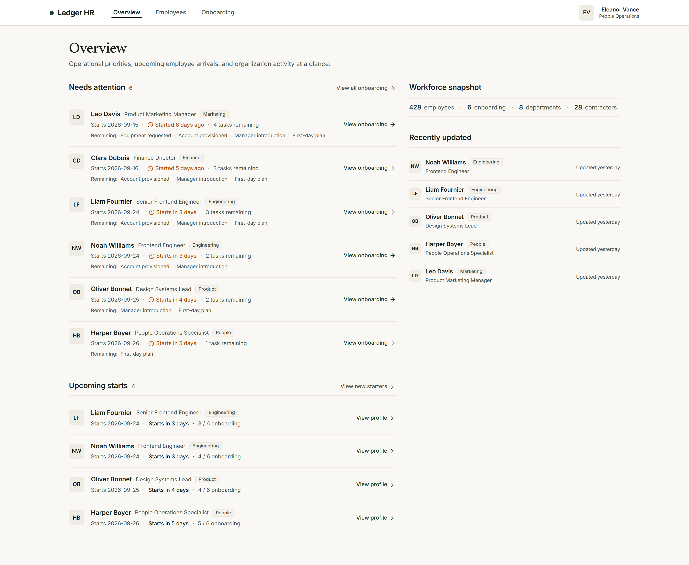

# Nyx People

A React 19 and TypeScript demo for browsing an employee directory and managing onboarding checklists with fictional data.

[Open the live demo](https://nyx-people.vercel.app/)



### Try the onboarding workflow

1. Open **Overview** in a fresh browser profile. **Upcoming starts** shows arrivals in the next 14 days. In **Needs attention**, look for someone whose start date has passed and who still has tasks to complete.
2. From **Needs attention**, open Noah Williams's checklist and complete **Account provisioned** and **Manager introduction**.
3. Return to **Overview**. Noah drops out of **Needs attention** once both tasks are complete.

---

## Project Context & Origin

Nyx People is an **independent, portfolio-grade reinterpretation** inspired by an earlier school project assignment (HRnet). 

- **Clean Slate**: Developed as a completely independent codebase with clean version history, modern tooling, and production software engineering practices.
- **Independence**: It does not import, fork, or modify the historical jury repositories (`DRGYZ/hrnet-react`, `DRGYZ/react-hrnet-modal`).
- **Scope**: Replaces legacy jQuery/table plugins with a modern React 19 architecture featuring TanStack Table v8, React Hook Form v7, Zod v3 schema validation, client-side persistence with corruption recovery, and Mock Service Worker (MSW) for offline-first operational simulation.

---

## Core Features & Workflows

### 1. Operational Overview (`/overview`)
- **Action-Oriented Dashboard**: Answers the core operational question: *"What needs my attention right now?"*
- **Needs Attention Triage**: Highlights overdue onboarding milestones, incomplete tasks, and pending actions.
- **Upcoming Starts**: Shows eligible employees starting today or within the next 14 days.
- **Recently Updated**: Audit trail of recent employee profile and record changes.
- **Workforce Snapshot**: High-level organizational metrics (headcount, active onboarding count, department distribution).

### 2. Employee Directory (`/employees`)
- **High-Density Data Grid**: Powered by TanStack Table v8 with multi-column sorting, department filtering, status tabs, and pagination.
- **Viewport-Aware Responsive DOM**: Conditionally mounts structured semantic cards on mobile devices (`<= 768px`) or the full data grid on desktop screens, avoiding duplicated DOM/accessibility nodes and horizontal overflow.
- **Deep-Linkable URL State**: Search terms, department filters, active tabs, sorting, and pagination are synchronized with URL query parameters for bookmarking and back/forward navigation.

### 3. Employee Creation & Editing (`/employees/new`, `/employees/:id/edit`)
- **Multi-Section Forms**: Organized into Identity, Role & Placement, Office Location, and Address.
- **Strict Validation**: Zod schema validation integrated with React Hook Form, featuring real-time inline errors and an accessible top-of-form error summary with skip links.
- **Manager Combobox**: Accessible, searchable combobox with debounced filtering (150ms), keyboard navigation (Arrow Up/Down, Enter, Escape), active-descendant tracking, and signal abort on rapid typing.
- **Unsaved Changes Guard**: Custom navigation blocker intercepting internal route transitions and browser back/forward buttons when forms are dirty.

### 4. Employee Profile & History (`/employees/:id`)
- **Institutional Profile Header**: Summary cards, department badge, role metadata, and quick action buttons.
- **Context Preservation**: Seamlessly navigates back to the exact directory state (page, filters, query) using search parameter preservation.
- **Direct Onboarding Access**: One-click access to the employee's onboarding checklist.

### 5. Onboarding Pipeline (`/onboarding`, `/employees/:employeeId/onboarding`)
- **Cohort Tracking**: Monitor employees across Pre-boarding, Day One, and First Month phases.
- **Checklist Automation**: Automatic initialization of canonical onboarding tasks upon employee creation.
- **Transactional Task Completion**: Optimistic UI toggles with request serialization and cross-application state synchronization (Profile, Overview, and Directory reflect updates instantly).

---

## Technical Architecture

```
src/
├── app/                  # Application bootstrap, routing, shell, navigation
│   ├── router/           # React Router v7 routes with React.lazy code splitting
│   ├── AppShell.tsx      # Main layout, SkipLink, Navigation, Suspense boundaries
│   └── config.ts         # Navigation items and demo user context
├── components/ui/        # Shared buttons, inputs, badges, dialogs, and loading states
├── data/                 # Data layer, fixtures, mock store, and MSW handlers
│   └── mock/             # MSW handlers, 428 employee fixtures, and localStorage-backed store
├── domain/               # Employee models, schemas, clock, and onboarding and overview logic
├── features/             # Directory, form, profile, onboarding, and overview components
├── routes/               # Route pages
└── test/                 # Unit and integration test suites
```

### Performance Optimizations
- **Route-Level Code Splitting**: All 8 route boundaries are loaded asynchronously via `React.lazy()`.
- **Vendor Splitting**: Critical framework dependencies (`react`, `react-dom`, `react-router-dom`) are partitioned into a cached `react-vendor` chunk. Heavy libraries like `@tanstack/react-table` and `react-hook-form` / `zod` only load when navigating to the Directory or Form routes.
- **Sub-500 kB Production Chunks**: Eliminates monolithic bundles; the initial JavaScript footprint is reduced from >1,020 kB to ~392 kB application runtime + 319 kB cached vendor.
- **Single-Tree Responsive Rendering**: `useMediaQuery` mounts either the table or the card list, avoiding hidden duplicates in the accessibility tree and layout recalculations.

### Accessibility (WCAG 2.2 AA)
- **Skip Link**: Top-level skip link to bypass navigation directly to `#main-content`.
- **Route Focus Management**: Automatically moves programmatic focus to the route's `<h1>` heading upon navigation with `tabIndex={-1}`.
- **Landmark Structure**: Semantic header, navigation, and single `<main id="main-content">` landmark per view.
- **Automated Audits**: Automated `@axe-core/playwright` accessibility audits pass with 0 violations across all core routes on desktop and mobile viewports.

---

## Getting Started

### Prerequisites
- **Node.js**: `v20.x` or `v22.x`
- **npm**: `v10.x` or later

### Installation
```bash
# Clone repository
git clone https://github.com/DRGYZ/nyx-people.git
cd nyx-people

# Install dependencies (respecting package-lock)
npm ci
```

### Development Server
```bash
npm run dev
```
Starts the local Vite dev server at `http://localhost:5173`. MSW will automatically register its Service Worker in development and intercept `/api/*` requests.

---

## Verification & Commands

Nyx People enforces a comprehensive verification pipeline covering type safety, linting, unit/integration testing, production compilation, and end-to-end browser automation:

| Command | Description |
| :--- | :--- |
| `npm run check` | Runs TypeScript compiler check (`tsc --noEmit`) |
| `npm run lint` | Runs ESLint with modern flat config (`eslint .`) |
| `npm run test` | Runs Vitest unit and integration tests |
| `npm run test:watch` | Runs Vitest in interactive watch mode |
| `npm run test:e2e` | Runs Playwright tests on Chromium and Mobile Chrome |
| `npm run build` | Compiles production assets (`tsc -b && vite build`) |
| `npm run build:analyze` | Generates interactive bundle visualization (`stats.html`) |
| `npm run verify` | Runs the full release gate (`check` + `lint` + `test` + `build` + `test:e2e`) |
| `npm audit` | Checks dependencies against current security advisories |

---

## CI / Automated Pipeline

Continuous Integration is configured via **GitHub Actions** (`.github/workflows/ci.yml`). Every pull request and branch push automatically runs:
1. TypeScript strict type check (`npm run check`)
2. ESLint code quality & hook check (`npm run lint`)
3. Vitest unit and integration test suites (`npm run test`)
4. Production bundle build (`npm run build`)
5. Playwright end-to-end browser test suite (`npm run test:e2e -- --project=chromium`)

---

## Explicit Demo Limitations & Disclaimers

> [!NOTE]
> **This application is a frontend portfolio demonstration:**
> - **Synthetic / Fictional Data**: All employees, departments, emails, and phone numbers are fictional entities generated for demonstration purposes.
> - **Client-Side Mocking**: Network requests to `/api/*` are intercepted by **Mock Service Worker (MSW)** in the browser. There is no remote database or backend server.
> - **Persistence Model**: Employee edits and checklist progress are saved in this browser's `localStorage`. A fresh browser profile starts with 428 fictional employees. Onboarding start dates are set relative to the day the demo data is seeded, so a fresh session includes upcoming arrivals and starts that have already passed with unfinished tasks.
> - **No Authentication or Authorization**: Authentication and authorization are intentionally not implemented. The workspace operates as an open frontend demonstration without access controls or login flows (the header user profile is static contextual display only).
